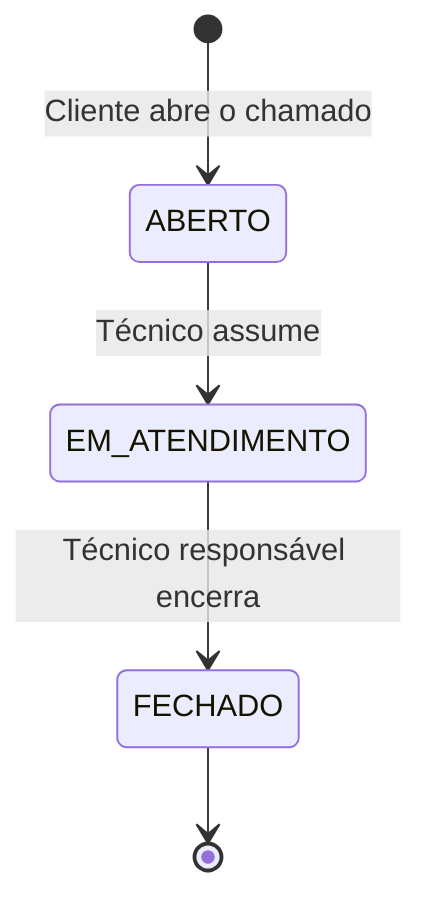

# 01 — Visão geral

## 1. O que é o TicketHub

O **TicketHub** é um MVP de **sistema de gerenciamento de chamados** (help desk)
desenvolvido como Trabalho de Conclusão de Curso (TCC). Ele permite que
funcionários de uma empresa abram solicitações de suporte e que a equipe
técnica as assuma e conclua, tudo por meio de um aplicativo mobile.

O sistema é composto por três partes:

| Parte | Tecnologia | Pasta |
|-------|------------|-------|
| Aplicativo mobile | React Native + Expo | `frontend/` |
| API REST | Node.js + Express | `backend/` |
| Banco de dados | PostgreSQL | `schema.sql` |

## 2. Problema e objetivo

Em muitas empresas pequenas, os pedidos de suporte de T.I. chegam por
mensagens soltas, sem rastreio de quem está atendendo nem do andamento. O
objetivo do TicketHub é oferecer um fluxo simples e rastreável:

> **abrir → assumir → encerrar**

com visibilidade clara do **status**, da **última atualização** e do
**responsável** por cada chamado.

## 3. Escopo do MVP

### Dentro do escopo

- Autenticação por e-mail e senha (JWT).
- Dois perfis de usuário com permissões distintas (cliente e técnico).
- Abertura de chamados com título, descrição e categoria.
- Listagem de chamados filtrada por perfil.
- Visualização dos detalhes de um chamado.
- Atribuição (assumir) e encerramento de chamados por técnicos.
- Aplicativo mobile para Android e iOS (via Expo).

### Fora do escopo (decisões conscientes do MVP)

- **Cadastro público de usuários** — as contas são provisionadas internamente
  pela equipe de T.I. (não existe tela nem rota de registro).
- Comentários/histórico de interações dentro do chamado.
- Anexos, notificações push e e-mail.
- Prioridade, SLA e relatórios.
- Reabertura de chamados fechados.
- Painel administrativo e gestão de usuários/categorias via interface.

Veja [12 — Limitações e roadmap](12-limitacoes-e-roadmap.md) para a evolução
planejada.

## 4. Perfis de usuário

| Perfil | Valor no banco | O que pode fazer |
|--------|----------------|------------------|
| **Cliente** | `CLIENTE` | Abrir chamados; ver **apenas os seus** chamados; ver detalhes dos próprios chamados |
| **Técnico** | `TECNICO` | Ver a fila de chamados não encerrados; ver detalhes de qualquer chamado; assumir chamados abertos; encerrar os chamados que assumiu |

Ambos podem autenticar-se e encerrar a sessão. Não existe um perfil
administrador no MVP.

### Matriz de permissões

| Ação | Cliente | Técnico |
|------|:-------:|:-------:|
| Autenticar-se / sair | ✅ | ✅ |
| Listar chamados | ✅ (só os seus) | ✅ (fila não encerrada) |
| Ver detalhes de um chamado | ✅ (só os seus) | ✅ (qualquer um) |
| Abrir chamado | ✅ | ❌ |
| Assumir chamado | ❌ | ✅ |
| Encerrar chamado | ❌ | ✅ (só o responsável) |
| Listar categorias | ✅ | ✅ |

## 5. Ciclo de vida de um chamado



| Status | Significado | Técnico responsável |
|--------|-------------|---------------------|
| `ABERTO` | Aguardando atendimento | Nenhum |
| `EM_ATENDIMENTO` | Um técnico assumiu | Definido |
| `FECHADO` | Atendimento concluído | Mantido (histórico) |

Não há transições de volta: um chamado `FECHADO` não pode ser reaberto, e um
chamado `EM_ATENDIMENTO` não pode ser devolvido à fila.

## 6. Stack tecnológica

### Backend (`backend/`)

| Item | Tecnologia | Versão (package.json) |
|------|------------|-----------------------|
| Runtime | Node.js | 18+ recomendado |
| Framework HTTP | Express | ^4.19.2 |
| Banco de dados | PostgreSQL via `pg` | ^8.11.5 |
| Autenticação | `jsonwebtoken` | ^9.0.2 |
| Hash de senhas | `bcryptjs` | ^2.4.3 |
| CORS | `cors` | ^2.8.5 |
| Variáveis de ambiente | `dotenv` | ^16.4.5 |
| Testes | Jest | ^29.7.0 |
| Dev server | Nodemon | ^3.1.0 |

### Frontend (`frontend/`)

| Item | Tecnologia | Versão (package.json) |
|------|------------|-----------------------|
| Framework | React Native | 0.74.5 |
| Toolchain | Expo SDK | ~51.0.0 |
| React | React | 18.2.0 |
| Navegação | React Navigation (native-stack) | ^6.x |
| Persistência local | AsyncStorage | 1.23.1 |
| Barra de status | expo-status-bar | ~1.12.1 |

## 7. Estrutura do repositório

```
tickethub/
├── backend/                  API REST (Node.js + Express)
│   ├── server.js             Ponto de entrada (sobe o servidor HTTP)
│   ├── src/
│   │   ├── app.js            Configura o Express (middlewares, rotas, 404)
│   │   ├── config/           Conexão com o PostgreSQL
│   │   ├── controllers/      Camada HTTP (req/res)
│   │   ├── middlewares/      Autenticação (JWT) e autorização (perfil)
│   │   ├── repositories/     Acesso a dados (SQL)
│   │   ├── routes/           Definição das rotas
│   │   ├── services/         Regras de negócio
│   │   └── utils/            AppError
│   └── tests/                Testes unitários (Jest)
├── frontend/                 App mobile (React Native + Expo)
│   ├── App.js                Raiz do app
│   └── src/
│       ├── context/          AuthContext (sessão)
│       ├── navigation/       AppNavigator (pilha de telas)
│       ├── screens/          Login, Lista, Novo chamado, Detalhes
│       ├── services/         api.js (cliente HTTP)
│       └── theme/            Cores e status
├── docs/                     Esta documentação
├── schema.sql                Criação do banco + dados iniciais
└── README.md
```

## 8. Glossário

| Termo | Definição |
|-------|-----------|
| **Chamado** | Solicitação de suporte aberta por um cliente (*ticket*) |
| **Cliente** | Usuário que abre chamados |
| **Técnico** | Usuário que atende chamados |
| **Categoria de serviço** | Classificação do chamado (ex.: Hardware, Software) |
| **Assumir** | Ato do técnico de se tornar responsável por um chamado `ABERTO` |
| **Encerrar** | Ato do técnico responsável de mudar o status para `FECHADO` |
| **JWT** | *JSON Web Token* — token assinado que identifica o usuário nas requisições |
| **Hash** | Resultado irreversível (bcrypt) usado para guardar senhas |
| **MVP** | *Minimum Viable Product* — versão mínima funcional |
| **LGPD** | Lei Geral de Proteção de Dados Pessoais (Lei nº 13.709/2018) |

## 9. Autoria

Projeto desenvolvido por **César Eduardo de Almeida Canoff** como Trabalho de
Conclusão de Curso (polo Naviraí).
