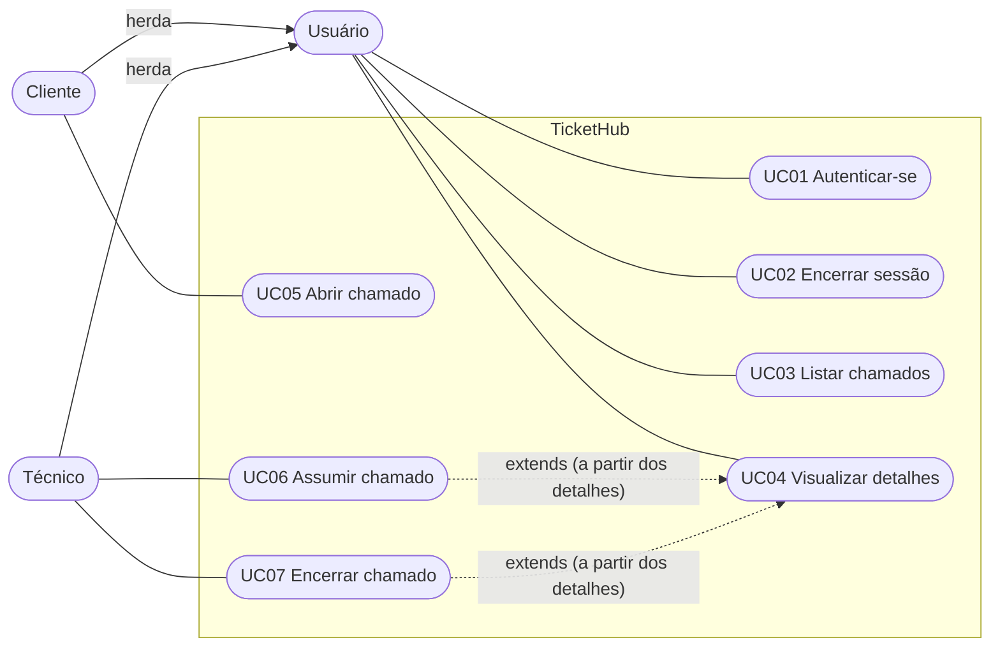

# 03 — Casos de uso

Os casos de uso abaixo descrevem o que o sistema oferece a cada ator. Cada caso
traz também o **mapeamento para o código**, para facilitar a navegação entre a
especificação e a implementação.

## 1. Atores

| Ator | Descrição |
|------|-----------|
| **Usuário** | Ator abstrato: qualquer pessoa com conta. Concentra o que é comum aos dois perfis (autenticar-se, listar, ver detalhes, sair). Cliente e Técnico herdam essas permissões |
| **Cliente** | Funcionário que precisa de suporte. Abre chamados e acompanha apenas os seus |
| **Técnico** | Profissional de suporte. Vê a fila, assume chamados e encerra aqueles pelos quais é responsável |

## 2. Diagrama de casos de uso

## 3. Resumo

| UC | Nome | Ator | Endpoint | Tela |
|----|------|------|----------|------|
| UC01 | Autenticar-se | Usuário | `POST /api/auth/login` | `LoginScreen` |
| UC02 | Encerrar sessão | Usuário | — (local) | `ChamadosListScreen` (botão "Sair") |
| UC03 | Listar chamados | Usuário | `GET /api/chamados` | `ChamadosListScreen` |
| UC04 | Visualizar detalhes | Usuário | `GET /api/chamados/:id` | `ChamadoDetailsScreen` |
| UC05 | Abrir chamado | Cliente | `GET /api/categorias` + `POST /api/chamados` | `CreateChamadoScreen` |
| UC06 | Assumir chamado | Técnico | `PATCH /api/chamados/:id/assumir` | `ChamadoDetailsScreen` |
| UC07 | Encerrar chamado | Técnico | `PATCH /api/chamados/:id/encerrar` | `ChamadoDetailsScreen` |

---

## UC01 — Autenticar-se

| Campo | Descrição |
|-------|-----------|
| **Ator** | Usuário (Cliente ou Técnico) |
| **Objetivo** | Acessar o sistema com as credenciais fornecidas pela empresa |
| **Pré-condições** | Conta ativa criada previamente pelo T.I.; app aberto e sem sessão ativa |
| **Pós-condições** | Usuário autenticado; JWT emitido e guardado no dispositivo; lista de chamados exibida |
| **Requisitos** | RF01, RNF01, RNF06 |

**Fluxo principal**

1. O usuário informa e-mail e senha na tela de login.
2. O usuário aciona **Entrar**.
3. O sistema verifica se os dois campos foram preenchidos.
4. O sistema busca um usuário **ativo** com o e-mail informado.
5. O sistema compara a senha com o hash armazenado (bcrypt).
6. O sistema gera o JWT (contendo `id` e `tipo`) e devolve os dados do usuário.
7. O app guarda a sessão e exibe a lista de chamados.

**Fluxos alternativos**

| ID | Condição | Resultado |
|----|----------|-----------|
| A1 | Campos vazios | "Informe e-mail e senha." (o app valida antes; a API devolve 400) |
| A2 | E-mail inexistente, conta inativa ou senha incorreta | "Credenciais inválidas." (401), mensagem única de propósito |
| A3 | Falha de comunicação com o servidor | O app exibe a mensagem de erro e permite tentar de novo |

**Código:** `LoginScreen.js` → `AuthContext.login` → `api.login` →
`authRoutes` → `authController.login` → `authService.login` →
`usuarioRepository.buscarPorEmail`.

---

## UC02 — Encerrar sessão

| Campo | Descrição |
|-------|-----------|
| **Ator** | Usuário (Cliente ou Técnico) |
| **Objetivo** | Sair do sistema, removendo a sessão do dispositivo |
| **Pré-condições** | Usuário autenticado |
| **Pós-condições** | Token e dados do usuário removidos do armazenamento local; tela de login exibida |
| **Requisitos** | RF01, RNF01 |

**Fluxo principal**

1. O usuário aciona **Sair** na tela de listagem.
2. O app remove token e dados do usuário do `AsyncStorage`.
3. O app exibe a tela de login.

**Fluxos alternativos:** não há.

> O logout é **somente local**: o JWT já emitido continua tecnicamente válido
> até expirar, pois a API não mantém lista de revogação. Veja
> [12 — Limitações](12-limitacoes-e-roadmap.md).

**Código:** `ChamadosListScreen.js` → `AuthContext.logout`.

---

## UC03 — Listar chamados

| Campo | Descrição |
|-------|-----------|
| **Ator** | Usuário (Cliente ou Técnico) |
| **Objetivo** | Exibir os chamados que o perfil pode acompanhar |
| **Pré-condições** | Usuário autenticado |
| **Pós-condições** | Lista exibida com data da última atualização, título e status |
| **Requisitos** | RF03, RF04, RF06, RF07 (RNF01: cliente nunca vê chamados de outros) |

**Fluxo principal**

1. O usuário acessa a tela de listagem (ou puxa a tela para baixo para atualizar).
2. O app solicita a lista à API, enviando o token.
3. O sistema identifica o perfil.
4. **Cliente:** retorna só os chamados abertos por ele, do **mais recentemente atualizado** para o mais antigo.
5. **Técnico:** retorna os chamados **não encerrados** (abertos e em atendimento), do **mais antigo** para o mais novo.
6. O app exibe data de atualização, título e status colorido.

**Fluxos alternativos**

| ID | Condição | Resultado |
|----|----------|-----------|
| A1 | Nenhum chamado | "Nenhum chamado encontrado." |
| A2 | Token ausente, inválido ou expirado | API responde 401; a lista não é retornada |

**Código:** `ChamadosListScreen.js` → `api.listarChamados` →
`chamadoController.listar` → `chamadoService.listar` →
`chamadoRepository.listarPorCliente | listarParaTecnico`.

---

## UC04 — Visualizar detalhes do chamado

| Campo | Descrição |
|-------|-----------|
| **Ator** | Usuário (Cliente ou Técnico) |
| **Objetivo** | Consultar todas as informações de um chamado |
| **Pré-condições** | Usuário autenticado; chamado existente |
| **Pós-condições** | Detalhes exibidos; ações permitidas ao perfil disponíveis (UC06/UC07 para técnico) |
| **Requisitos** | RF06, RF07, RF08, RNF01 |

**Fluxo principal**

1. O usuário seleciona um chamado na lista (UC03).
2. O app solicita os dados à API.
3. O sistema localiza o chamado.
4. O sistema verifica a permissão: cliente só acessa os que abriu; técnico acessa qualquer um.
5. O app exibe número (com zeros à esquerda), título, status, descrição, categoria, datas de criação e atualização e técnico responsável (ou "Ainda não atribuído").

**Fluxos alternativos**

| ID | Condição | Resultado |
|----|----------|-----------|
| A1 | Chamado inexistente | "Chamado não encontrado." (404) |
| A2 | Cliente acessa chamado de outro cliente | "Você não tem permissão para ver este chamado." (403) |

**Código:** `ChamadoDetailsScreen.js` → `api.buscarChamado` →
`chamadoController.detalhes` → `chamadoService.buscarDetalhes`.

---

## UC05 — Abrir chamado

| Campo | Descrição |
|-------|-----------|
| **Ator** | Cliente |
| **Objetivo** | Registrar uma nova solicitação de suporte |
| **Pré-condições** | Autenticado como Cliente; existem categorias ativas |
| **Pós-condições** | Chamado criado com status `ABERTO`, vinculado ao cliente e sem técnico; aparece na lista do cliente |
| **Requisitos** | RF02, RF05 |

**Fluxo principal**

1. O cliente aciona **+ Novo chamado**.
2. O app carrega as categorias ativas e exibe o formulário.
3. O cliente informa título, descrição e seleciona a categoria.
4. O cliente aciona **Criar chamado**.
5. O sistema valida perfil, título, descrição e categoria.
6. O sistema registra o chamado com status `ABERTO` e `cliente_id` do usuário autenticado.
7. O app volta à lista, que passa a exibir o novo chamado.

**Fluxos alternativos**

| ID | Condição | Resultado |
|----|----------|-----------|
| A1 | Campo obrigatório vazio | App: "Preencha título, descrição e categoria de atendimento." (não envia) |
| A2 | Categoria inexistente ou inativa | "Categoria de serviço inválida." (400) |
| A3 | Usuário com perfil Técnico | Bloqueado com 403 (ver nota abaixo) |

> **Nota sobre A3:** a rota usa `authorize('CLIENTE')`, que responde
> "Você não tem permissão para esta ação." (403) *antes* de chegar ao service.
> A mensagem "Apenas clientes podem abrir chamados." do service é uma
> segunda barreira (defesa em profundidade), acionada, por exemplo, em testes
> unitários que chamam o service direto.

**Código:** `CreateChamadoScreen.js` → `api.listarCategorias` /
`api.criarChamado` → `chamadoController.criar` → `chamadoService.criar` →
`categoriaRepository.buscarPorId` + `chamadoRepository.criar`.

---

## UC06 — Assumir chamado

| Campo | Descrição |
|-------|-----------|
| **Ator** | Técnico |
| **Objetivo** | Tornar-se responsável por um chamado não atribuído |
| **Pré-condições** | Autenticado como Técnico; chamado `ABERTO`; técnico na tela de detalhes |
| **Pós-condições** | Técnico responsável definido; status `EM_ATENDIMENTO`; `atualizado_em` renovado |
| **Requisitos** | RF02, RF09 |

**Fluxo principal**

1. O técnico abre os detalhes de um chamado `ABERTO`.
2. O app exibe **Assumir chamado**.
3. O técnico aciona o botão.
4. O sistema verifica perfil, existência do chamado e status `ABERTO`.
5. O sistema registra o técnico e altera o status para `EM_ATENDIMENTO`.
6. O app recarrega os detalhes, agora com o técnico responsável.

**Fluxos alternativos**

| ID | Condição | Resultado |
|----|----------|-----------|
| A1 | Chamado já em atendimento ou encerrado | "Este chamado já está em atendimento ou foi encerrado." (409) |
| A2 | Chamado inexistente | "Chamado não encontrado." (404) |
| A3 | Usuário Cliente | 403 (`authorize`) — a mensagem do service é "Apenas técnicos podem assumir chamados." |

**Código:** `ChamadoDetailsScreen.handleAssumir` → `api.assumirChamado` →
`chamadoController.assumir` → `chamadoService.assumir` →
`chamadoRepository.atribuirTecnico`.

---

## UC07 — Encerrar chamado

| Campo | Descrição |
|-------|-----------|
| **Ator** | Técnico (responsável pelo chamado) |
| **Objetivo** | Finalizar o atendimento após concluir o serviço |
| **Pré-condições** | Autenticado como Técnico; chamado `EM_ATENDIMENTO` e atribuído a ele; técnico nos detalhes |
| **Pós-condições** | Status `FECHADO`; `atualizado_em` renovado |
| **Requisitos** | RF10, RF11 |

**Fluxo principal**

1. O técnico abre os detalhes de um chamado que assumiu.
2. O app exibe **Fechar chamado** (somente ao responsável, com o chamado em atendimento).
3. O técnico aciona o botão.
4. O sistema verifica perfil, existência, se o técnico é o responsável e se o chamado ainda não está fechado.
5. O sistema altera o status para `FECHADO`.
6. O app recarrega os detalhes e exibe "Fechado".

**Fluxos alternativos**

| ID | Condição | Resultado |
|----|----------|-----------|
| A1 | Técnico que não é o responsável (inclui chamado ainda sem responsável) | "Apenas o técnico responsável pode encerrar este chamado." (403) |
| A2 | Chamado já encerrado | "Este chamado já está encerrado." (409) |
| A3 | Usuário Cliente | 403 (`authorize`) |

**Código:** `ChamadoDetailsScreen.handleEncerrar` → `api.encerrarChamado` →
`chamadoController.encerrar` → `chamadoService.encerrar` →
`chamadoRepository.atualizarStatus`.
