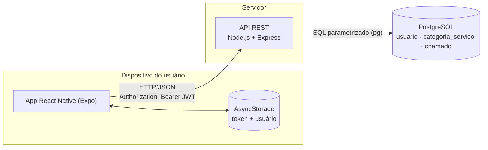
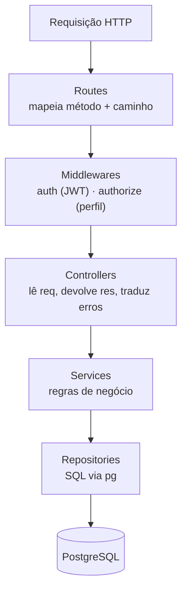
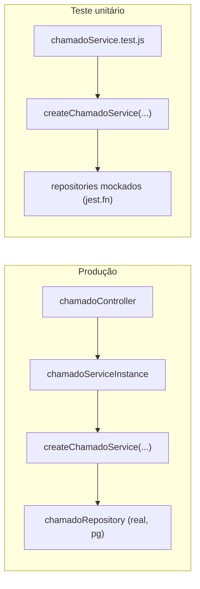
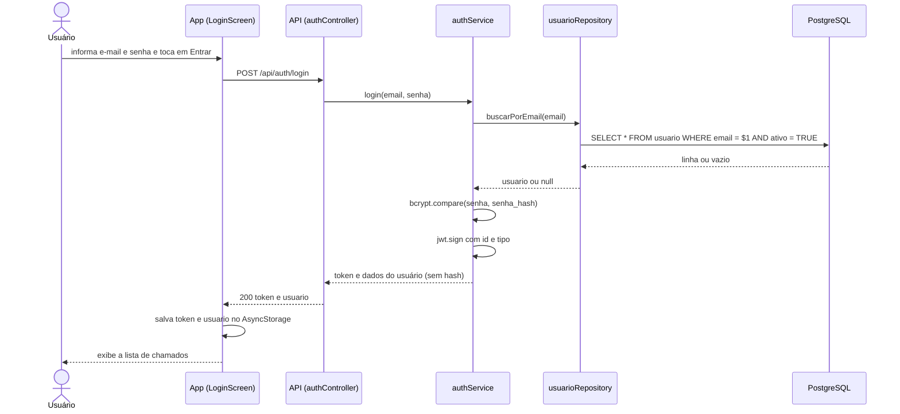
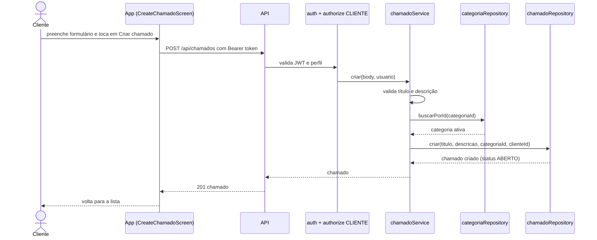
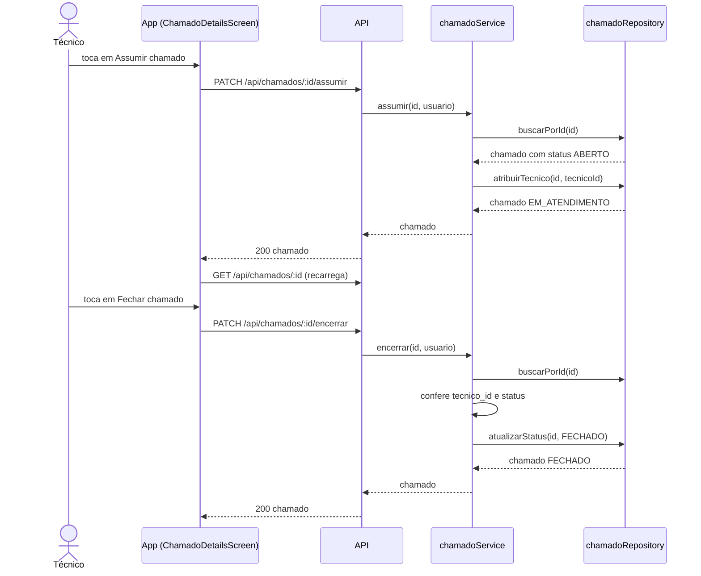
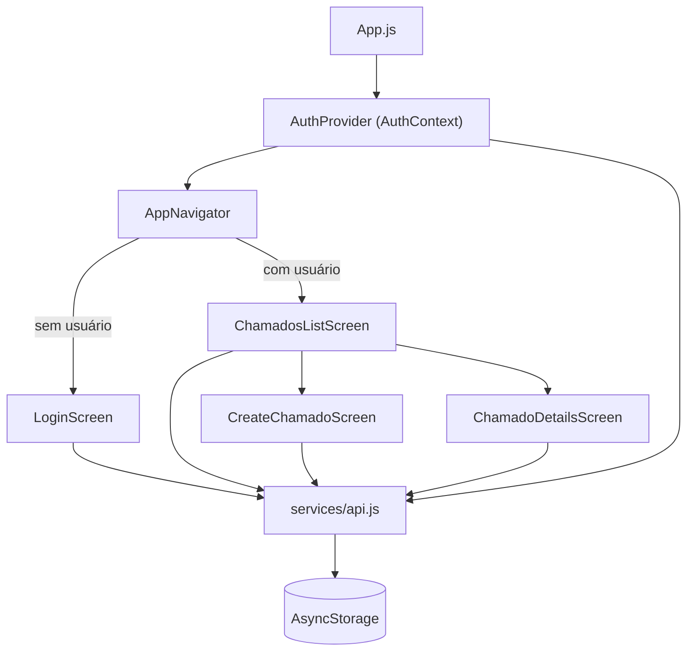

# 04 — Arquitetura

## 1. Visão macro



- O app e a API se comunicam **exclusivamente por HTTP/JSON**.
- A autenticação é **stateless**: cada requisição carrega o JWT; o servidor
  não guarda sessão.
- Só a API acessa o banco. O app nunca fala direto com o PostgreSQL.

## 2. Arquitetura do backend em camadas

O backend segue uma arquitetura em camadas com responsabilidades bem separadas:



| Camada | Pasta | Responsabilidade | Conhece HTTP? | Conhece SQL? |
|--------|-------|------------------|:-------------:|:------------:|
| Routes | `src/routes/` | Associar rotas a controllers e middlewares | ✅ | ❌ |
| Middlewares | `src/middlewares/` | Autenticar (JWT) e autorizar (perfil) | ✅ | ❌ |
| Controllers | `src/controllers/` | Extrair dados da requisição e formatar a resposta/erro | ✅ | ❌ |
| Services | `src/services/` | **Regras de negócio** e validações | ❌ | ❌ |
| Repositories | `src/repositories/` | Consultas SQL | ❌ | ✅ |
| Config | `src/config/` | Pool de conexão com o PostgreSQL | ❌ | ✅ |
| Utils | `src/utils/` | `AppError` | ❌ | ❌ |

**Regra de dependência:** cada camada só conhece a imediatamente abaixo.
Services nunca importam `express`; repositories nunca conhecem regras de negócio.
Isso é o que torna os services testáveis sem HTTP e sem banco.

## 3. Injeção de dependência (factory functions)

Os services são criados por **funções fábrica** que recebem suas dependências
por parâmetro:

```js
// authService.js
function createAuthService({ usuarioRepository, bcryptLib = bcrypt, jwtLib = jwt } = {}) { ... }

// chamadoService.js
function createChamadoService({ chamadoRepository, categoriaRepository }) { ... }
```

A **montagem real** (service + repository de verdade) acontece em um único
lugar, nos arquivos `*Instance.js`:

```js
// chamadoServiceInstance.js
module.exports = createChamadoService({ chamadoRepository, categoriaRepository });
```

Nos testes, o service é criado manualmente com repositories falsos (mocks de
Jest), sem tocar no PostgreSQL:



Benefícios: testes rápidos e determinísticos, sem infraestrutura, e baixo
acoplamento entre regra de negócio e persistência.

## 4. Tratamento de erros

`AppError` (`src/utils/AppError.js`) estende `Error` com um `statusCode` HTTP.
Os services lançam `AppError` para falhas de regra; os controllers capturam e
respondem:

```js
catch (err) {
  return res.status(err.statusCode || 500).json({ erro: err.message });
}
```

| Origem do erro | Status | Corpo |
|----------------|--------|-------|
| `AppError` lançado pelo service | `statusCode` do erro | `{ "erro": "<mensagem>" }` |
| Middleware `auth` | 401 | `{ "erro": "Token não informado." }` ou `"Token inválido ou expirado."` |
| Middleware `authorize` | 403 | `{ "erro": "Você não tem permissão para esta ação." }` |
| Rota inexistente | 404 | `{ "erro": "Rota não encontrada." }` |
| Erro inesperado (ex.: falha de banco) | 500 | `{ "erro": "<err.message>" }` (ver [limitações](12-limitacoes-e-roadmap.md)) |

Todas as respostas de erro usam a chave `erro` em português, o que simplifica o
tratamento no app (`api.js` lê `dados.erro`).

## 5. Fluxos principais (diagramas de sequência)

### 5.1 Login



### 5.2 Abrir chamado



### 5.3 Assumir e encerrar chamado



## 6. Arquitetura do frontend



- **Estado global** mínimo: apenas a sessão (`usuario`), via Context API. Não há
  Redux nem outra biblioteca de estado.
- **Estado de tela** (listas, formulários, loading, erro) fica em `useState`
  local de cada tela.
- **Navegação condicional:** o `AppNavigator` monta pilhas diferentes conforme
  exista ou não `usuario`. Ao fazer login/logout, a troca de tela é automática.
- **Camada de rede única:** todas as chamadas passam por `services/api.js`, que
  injeta o token e padroniza erros.

Detalhes em [08 — Frontend](08-frontend.md).

## 7. Decisões de projeto

| Decisão | Motivo |
|---------|--------|
| Camadas + factory functions | Regra de negócio testável sem banco nem HTTP |
| `AppError` com `statusCode` | Services expressam falhas de negócio sem conhecer HTTP |
| JWT stateless | Simplicidade; sem tabela de sessões no MVP |
| `usuario` única para cliente e técnico (coluna `tipo`) | Evita duplicação; perfis têm os mesmos dados cadastrais |
| Enums como `VARCHAR` + `CHECK` | Portável e simples; evita `CREATE TYPE` no MVP |
| SQL puro com `pg` (sem ORM) | Controle total das consultas e menos dependências |
| `atualizado_em` por trigger | Garante consistência independentemente de quem altera os dados |
| Sem cadastro público | Requisito de controle de acesso: contas criadas pelo T.I. |
| Sem `components/` compartilhados | Telas pequenas e independentes no MVP |
