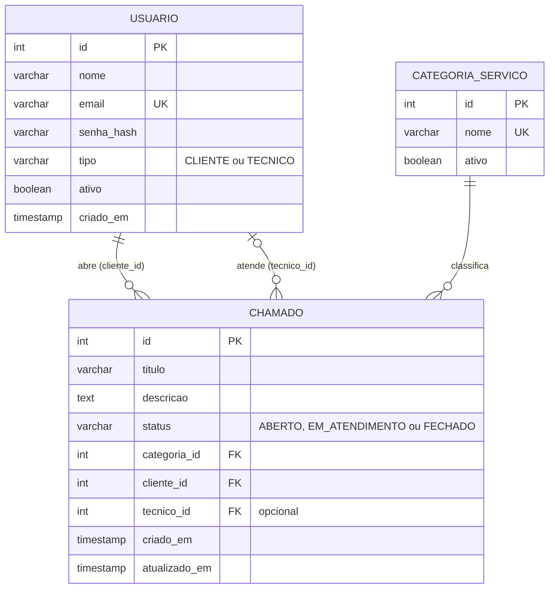
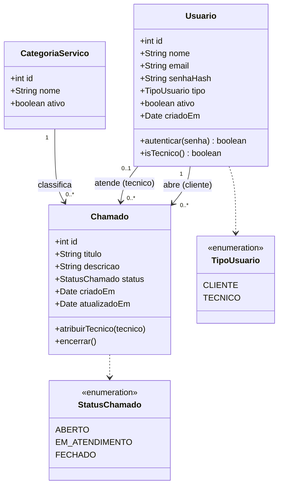

# 05 — Banco de dados

SGBD: **PostgreSQL**. O script completo (DDL + seed) está em [`schema.sql`](../schema.sql).

> ⚠️ O `schema.sql` começa com `DROP TABLE IF EXISTS ... CASCADE`. Executá-lo
> **apaga e recria** as tabelas. Use apenas em ambiente de desenvolvimento.

## 1. Modelo entidade-relacionamento



## 2. Diagrama de classes do domínio

O modelo relacional deriva do diagrama de classes da Etapa 3 do TCC:



As **operações** (`autenticar`, `atribuirTecnico`, `encerrar`) não existem no
banco: são implementadas na camada de services (`authService`,
`chamadoService`).

## 3. Regras de transformação classe → tabela

| Elemento no diagrama de classes | Elemento no banco |
|---------------------------------|-------------------|
| Classe | Tabela em minúsculas com underline (`CategoriaServico` → `categoria_servico`) |
| Atributo | Coluna com tipo equivalente (Integer → `SERIAL/INTEGER`, String → `VARCHAR/TEXT`, Boolean → `BOOLEAN`, Date → `TIMESTAMP`) |
| Atributo `id` | `PRIMARY KEY` com `SERIAL` |
| Associação 1 para 0..* | FK no lado "muitos", `NOT NULL` |
| Associação 0..1 para 0..* | FK no lado "muitos", aceita `NULL` (`tecnico_id`) |
| Enumeração | `VARCHAR` com `CHECK` |
| Atributo único | `UNIQUE` |
| Operações | Não geram objetos no banco |

## 4. Dicionário de dados

### 4.1 `usuario`

| Coluna | Tipo | Restrições | Descrição |
|--------|------|------------|-----------|
| `id` | `SERIAL` | PK | Identificador |
| `nome` | `VARCHAR(120)` | NOT NULL | Nome completo |
| `email` | `VARCHAR(160)` | NOT NULL, UNIQUE | Login do usuário |
| `senha_hash` | `VARCHAR(255)` | NOT NULL | Hash bcrypt da senha |
| `tipo` | `VARCHAR(20)` | NOT NULL, CHECK (`CLIENTE`, `TECNICO`) | Perfil |
| `ativo` | `BOOLEAN` | NOT NULL, DEFAULT `TRUE` | Conta ativa (inativa não faz login) |
| `criado_em` | `TIMESTAMP` | NOT NULL, DEFAULT `CURRENT_TIMESTAMP` | Data de criação |

### 4.2 `categoria_servico`

| Coluna | Tipo | Restrições | Descrição |
|--------|------|------------|-----------|
| `id` | `SERIAL` | PK | Identificador |
| `nome` | `VARCHAR(100)` | NOT NULL, UNIQUE | Nome exibido no app |
| `ativo` | `BOOLEAN` | NOT NULL, DEFAULT `TRUE` | Se `FALSE`, some da lista sem apagar histórico |

### 4.3 `chamado`

| Coluna | Tipo | Restrições | Descrição |
|--------|------|------------|-----------|
| `id` | `SERIAL` | PK | Número do chamado |
| `titulo` | `VARCHAR(150)` | NOT NULL | Resumo |
| `descricao` | `TEXT` | NOT NULL | Detalhamento do problema |
| `status` | `VARCHAR(20)` | NOT NULL, DEFAULT `'ABERTO'`, CHECK (`ABERTO`, `EM_ATENDIMENTO`, `FECHADO`) | Situação |
| `categoria_id` | `INTEGER` | NOT NULL, FK → `categoria_servico(id)` | Categoria |
| `cliente_id` | `INTEGER` | NOT NULL, FK → `usuario(id)` | Quem abriu |
| `tecnico_id` | `INTEGER` | FK → `usuario(id)`, aceita NULL | Responsável (nulo até ser assumido) |
| `criado_em` | `TIMESTAMP` | NOT NULL, DEFAULT `CURRENT_TIMESTAMP` | Abertura |
| `atualizado_em` | `TIMESTAMP` | NOT NULL, DEFAULT `CURRENT_TIMESTAMP` | Atualizada pela trigger |

## 5. Constraints

| Nome | Tabela | Tipo | Regra |
|------|--------|------|-------|
| `chk_usuario_tipo` | `usuario` | CHECK | `tipo IN ('CLIENTE','TECNICO')` |
| `chk_chamado_status` | `chamado` | CHECK | `status IN ('ABERTO','EM_ATENDIMENTO','FECHADO')` |
| `fk_chamado_categoria` | `chamado` | FK | `categoria_id` → `categoria_servico(id)` |
| `fk_chamado_cliente` | `chamado` | FK | `cliente_id` → `usuario(id)` |
| `fk_chamado_tecnico` | `chamado` | FK | `tecnico_id` → `usuario(id)` |

> O banco **não** garante que `cliente_id` seja um usuário `CLIENTE` nem que
> `tecnico_id` seja um `TECNICO`; essa verificação é feita na camada de
> services.

## 6. Índices

| Índice | Coluna | Consulta que acelera |
|--------|--------|----------------------|
| `idx_chamado_cliente` | `chamado(cliente_id)` | Lista do cliente |
| `idx_chamado_tecnico` | `chamado(tecnico_id)` | Chamados por técnico |
| `idx_chamado_status` | `chamado(status)` | Fila do técnico (`status != 'FECHADO'`) |

As colunas `email` (UNIQUE) e `nome` da categoria (UNIQUE) ganham índice
implícito pelas constraints.

## 7. Trigger `trg_chamado_atualizado_em`

```sql
CREATE OR REPLACE FUNCTION set_atualizado_em() RETURNS TRIGGER AS $$
BEGIN
    NEW.atualizado_em = CURRENT_TIMESTAMP;
    RETURN NEW;
END;
$$ LANGUAGE plpgsql;

CREATE TRIGGER trg_chamado_atualizado_em
    BEFORE UPDATE ON chamado
    FOR EACH ROW EXECUTE FUNCTION set_atualizado_em();
```

A cada `UPDATE` em `chamado` (assumir, encerrar), `atualizado_em` é renovado
automaticamente. Por isso o código da aplicação **nunca** altera essa coluna.

## 8. Dados iniciais (seed)

**Usuários de teste** (senha de ambos: `123456`):

| Nome | E-mail | Perfil |
|------|--------|--------|
| Antonio Carlos Silveira | `antonio@test.com` | `CLIENTE` |
| Carlos Silva | `carlos.silva@test.com` | `TECNICO` |

**Categorias:** Erro de rede · Recuperacao de dados · Hardware · Software ·
Acesso e senha · Impressora · Outros.

**Chamado de exemplo:** "Backup nao esta funcionando" — categoria
*Recuperacao de dados*, aberto por Antonio, `ABERTO`, sem técnico.

> Os textos do seed não usam acentos de propósito, para evitar problemas de
> encoding em terminais Windows.

## 9. Consultas usadas pela aplicação

| Operação | Repository | SQL (resumo) |
|----------|-----------|--------------|
| Buscar usuário por e-mail | `usuarioRepository.buscarPorEmail` | `SELECT * FROM usuario WHERE email = $1 AND ativo = TRUE` |
| Listar categorias ativas | `categoriaRepository.listarAtivas` | `SELECT id, nome FROM categoria_servico WHERE ativo = TRUE ORDER BY nome` |
| Buscar categoria | `categoriaRepository.buscarPorId` | `SELECT * FROM categoria_servico WHERE id = $1` |
| Criar chamado | `chamadoRepository.criar` | `INSERT INTO chamado (titulo, descricao, categoria_id, cliente_id) VALUES ($1,$2,$3,$4) RETURNING id` |
| Buscar chamado | `chamadoRepository.buscarPorId` | `SELECT_BASE WHERE c.id = $1` |
| Listar do cliente | `chamadoRepository.listarPorCliente` | `SELECT_BASE WHERE c.cliente_id = $1 ORDER BY c.atualizado_em DESC` |
| Listar para técnico | `chamadoRepository.listarParaTecnico` | `SELECT_BASE WHERE c.status != 'FECHADO' ORDER BY c.criado_em ASC` |
| Assumir | `chamadoRepository.atribuirTecnico` | `UPDATE chamado SET tecnico_id = $1, status = 'EM_ATENDIMENTO' WHERE id = $2` |
| Alterar status | `chamadoRepository.atualizarStatus` | `UPDATE chamado SET status = $1 WHERE id = $2` |

`SELECT_BASE` junta `chamado` com `categoria_servico` (JOIN), com o cliente
(JOIN) e com o técnico (**LEFT JOIN**, pois pode ser nulo), retornando os
campos extras `categoria_nome`, `cliente_nome` e `tecnico_nome`.

## 10. Como criar o banco

```bash
# 1. Criar o banco (uma vez)
createdb -U postgres tickethub

# 2. Rodar o script (a partir da raiz do repositório)
psql -U postgres -d tickethub -f schema.sql
```

Veja o passo a passo completo em [09 — Instalação](09-instalacao-e-configuracao.md).

## 11. Como criar um novo usuário (provisionamento pelo T.I.)

Não há tela de cadastro. Gere o hash da senha e insira diretamente:

```bash
# dentro de backend/ (após npm install)
node -e "console.log(require('bcryptjs').hashSync('SenhaForte123', 10))"
```

```sql
INSERT INTO usuario (nome, email, senha_hash, tipo)
VALUES ('Maria Souza', 'maria@empresa.com', '<hash gerado>', 'CLIENTE');
```

Para desativar uma conta sem apagar o histórico:

```sql
UPDATE usuario SET ativo = FALSE WHERE email = 'maria@empresa.com';
```
