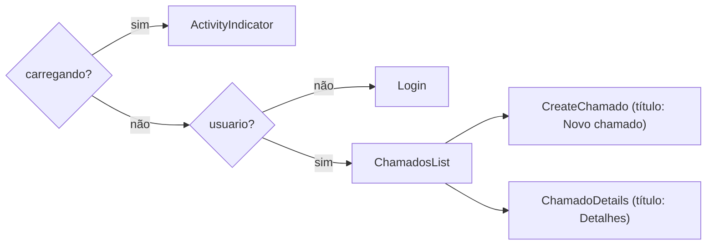

# 08 — Frontend

Aplicativo mobile em **React Native + Expo (SDK 51)**, em `frontend/`.

## 1. Scripts npm

| Comando | O que faz |
|---------|-----------|
| `npm start` | `expo start` — abre o servidor de desenvolvimento (QR Code) |
| `npm run android` | `expo start --android` |
| `npm run ios` | `expo start --ios` (somente macOS) |

## 2. Estrutura

```
frontend/
├── App.js                       Raiz: AuthProvider + AppNavigator
├── app.json                     Configuração do Expo
├── package.json
└── src/
    ├── context/AuthContext.js   Sessão (usuario, login, logout)
    ├── navigation/AppNavigator.js
    ├── screens/
    │   ├── LoginScreen.js
    │   ├── ChamadosListScreen.js
    │   ├── CreateChamadoScreen.js
    │   └── ChamadoDetailsScreen.js
    ├── services/api.js          Cliente HTTP
    └── theme/colors.js          Paleta e status
```

## 3. Configuração (`app.json`)

| Chave | Valor |
|-------|-------|
| `name` / `slug` | TicketHub / `tickethub` |
| `version` | 1.0.0 |
| `orientation` | `portrait` |
| `userInterfaceStyle` | `light` |
| `splash.backgroundColor` | `#1E3A8A` |

## 4. URL da API (`src/services/api.js`)

```js
const BASE_URL = 'http://localhost:3000/api';
```

**Altere conforme onde o app roda:**

| Ambiente | `BASE_URL` |
|----------|------------|
| Emulador iOS / Expo Web | `http://localhost:3000/api` |
| Emulador Android | `http://10.0.2.2:3000/api` |
| Celular físico (Expo Go) | `http://<IP-da-sua-máquina>:3000/api` (ex.: `http://192.168.0.10:3000/api`) |

Celular e computador precisam estar na **mesma rede Wi-Fi**, e o firewall deve
permitir a porta 3000. Veja [09 — Instalação](09-instalacao-e-configuracao.md).

### Como o cliente HTTP funciona

`request(path, options)`:

1. Lê o token em `AsyncStorage` (`@tickethub:token`).
2. Faz `fetch` com `Content-Type: application/json` e, se houver token,
   `Authorization: Bearer <token>`.
3. Converte a resposta em JSON (tolerando corpo vazio).
4. Se `!resposta.ok`, lança `Error(dados.erro || 'Ocorreu um erro. Tente novamente.')`.

Por isso as telas só precisam de `try/catch` e exibem `err.message`.

## 5. Autenticação e sessão (`context/AuthContext.js`)

`AuthProvider` expõe, via `useAuth()`:

| Valor | Tipo | Descrição |
|-------|------|-----------|
| `usuario` | objeto \| null | `{ id, nome, email, tipo }` do usuário logado |
| `carregando` | boolean | `true` enquanto restaura a sessão ao abrir o app |
| `login(email, senha)` | async | Chama a API, salva token e usuário, atualiza o estado |
| `logout()` | async | Remove token e usuário do armazenamento e limpa o estado |

**Chaves do AsyncStorage:** `@tickethub:token` e `@tickethub:usuario`.

Ao abrir o app, o provider lê `@tickethub:usuario`; se existir, o usuário já
entra logado (sem revalidar o token no servidor).

## 6. Navegação (`navigation/AppNavigator.js`)

Pilha nativa (`@react-navigation/native-stack`) **condicional**:



| Rota | Tela | Cabeçalho nativo |
|------|------|------------------|
| `Login` | `LoginScreen` | oculto |
| `ChamadosList` | `ChamadosListScreen` | oculto (a tela desenha o próprio) |
| `CreateChamado` | `CreateChamadoScreen` | visível, "Novo chamado" |
| `ChamadoDetails` | `ChamadoDetailsScreen` | visível, "Detalhes" (recebe `{ id }`) |

Como a troca depende de `usuario`, **login e logout navegam automaticamente**.

## 7. Telas

### 7.1 `LoginScreen`
- Campos: e-mail (teclado de e-mail, sem capitalização automática) e senha (oculta).
- Valida campos vazios localmente ("Informe e-mail e senha.").
- Chama `useAuth().login`; mostra erro da API em caso de falha e spinner no botão.
- Rodapé: "As credenciais de acesso são fornecidas pela equipe de T.I. da sua empresa."
- Não há link de cadastro ou "esqueci minha senha" (por requisito).

### 7.2 `ChamadosListScreen`
- Cabeçalho azul com o nome do app e o perfil ("Cliente" ou "Técnico") e botão **Sair**.
- Título da seção: "Meus chamados" (cliente) ou "Chamados" (técnico).
- `FlatList` com *pull-to-refresh*; cada cartão mostra data/hora de atualização, título e *badge* de status.
- Recarrega ao ganhar foco (`useFocusEffect`), então ao voltar de "Novo chamado" a lista já aparece atualizada.
- Lista vazia: "Nenhum chamado encontrado."
- Botão flutuante **+ Novo chamado** somente para clientes.
- Erros de carregamento hoje vão apenas para `console.warn` (sem aviso visual).

### 7.3 `CreateChamadoScreen`
- Campos: título, descrição (multilinha) e categoria (chips selecionáveis carregados de `GET /categorias`).
- Valida localmente: "Preencha título, descrição e categoria de atendimento."
- Em sucesso, `navigation.goBack()`.

### 7.4 `ChamadoDetailsScreen`
- Mostra: número com 5 dígitos (`00001`), título, *badge* de status, descrição, categoria, criado em, atualizado em e técnico responsável (ou "Ainda não atribuído").
- Recarrega ao ganhar foco.
- **Ações condicionais** (somente técnico):

| Botão | Aparece quando |
|-------|----------------|
| **Assumir chamado** | `tipo === 'TECNICO'` e `status === 'ABERTO'` |
| **Fechar chamado** | `tipo === 'TECNICO'`, `status === 'EM_ATENDIMENTO'` e `tecnico_id === usuario.id` |

- Após cada ação, recarrega os dados; erros da API aparecem em vermelho.

## 8. Tema (`theme/colors.js`)

| Token | Cor | Uso |
|-------|-----|-----|
| `primary` | `#1E3A8A` | Cabeçalhos, botões |
| `primaryDark` | `#152A63` | Reservada |
| `background` | `#F5F5F5` | Fundo das telas |
| `card` | `#FFFFFF` | Cartões e campos |
| `border` | `#E2E2E2` | Bordas |
| `text` / `textMuted` / `placeholder` | `#1A1A1A` / `#7A7A7A` / `#B0B0B0` | Textos |
| `success` | `#1D9E75` | Em atendimento |
| `warning` | `#EF9F27` | Aberto |
| `danger` | `#D85A30` | Mensagens de erro |

`statusInfo` mapeia cada status a rótulo e cor:

| Status | Rótulo | Cor |
|--------|--------|-----|
| `ABERTO` | Aberto | `warning` (âmbar) |
| `EM_ATENDIMENTO` | Em atendimento | `success` (verde) |
| `FECHADO` | Fechado | `textMuted` (cinza) |

## 9. Dependências

| Pacote | Uso |
|--------|-----|
| `expo` | Toolchain e runtime |
| `expo-status-bar` | Barra de status (`App.js`) |
| `react`, `react-native` | Base |
| `@react-navigation/native`, `@react-navigation/native-stack` | Navegação |
| `react-native-screens`, `react-native-safe-area-context` | Requisitos do React Navigation |
| `@react-native-async-storage/async-storage` | Persistência de token e usuário |

## 10. Dicas de desenvolvimento

- Para limpar o cache do Metro: `npx expo start -c`.
- Para forçar logout em desenvolvimento, limpe os dados do app (ou chame `logout`).
- Alinhe versões com o Expo: `npx expo install --check`.
