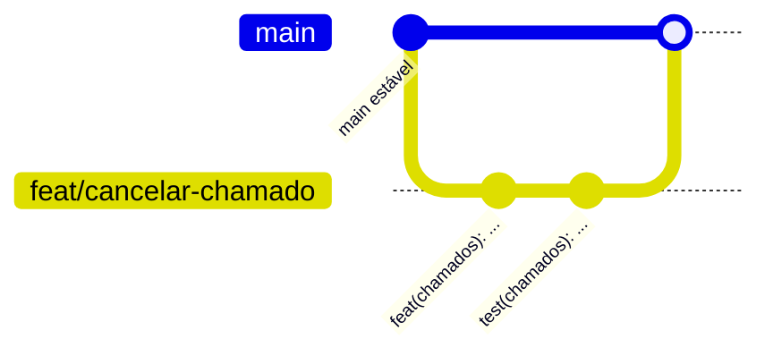

# 13 — Contribuição e convenções

## 1. Fluxo de trabalho com Git



1. Atualize a `main`: `git checkout main && git pull`.
2. Crie uma branch curta a partir dela (veja nomes abaixo).
3. Faça commits pequenos e coesos.
4. Abra um Pull Request descrevendo o que mudou e como testar.
5. Faça *merge* na `main` somente com os testes passando (`npm test`).

### Nomes de branch

| Prefixo | Uso | Exemplo |
|---------|-----|---------|
| `feat/` | Nova funcionalidade | `feat/comentarios-chamado` |
| `fix/` | Correção de bug | `fix/tecnico-ve-so-seus-chamados` |
| `docs/` | Documentação | `docs/atualiza-api` |
| `test/` | Testes | `test/middlewares-auth` |
| `refactor/` | Refatoração sem mudar comportamento | `refactor/chamado-repository` |
| `chore/` | Manutenção e configuração | `chore/atualiza-dependencias` |

## 2. Padrão de commits (Conventional Commits)

Formato:

```
<tipo>(<escopo>): <descrição curta no imperativo>

[corpo opcional: o quê e por quê]

[rodapé opcional: BREAKING CHANGE, Closes #123]
```

### Tipos

| Tipo | Quando usar |
|------|-------------|
| `feat` | Nova funcionalidade |
| `fix` | Correção de bug |
| `docs` | Somente documentação |
| `test` | Criação ou ajuste de testes |
| `refactor` | Mudança de código sem alterar comportamento |
| `style` | Formatação (espaços, ponto e vírgula), sem lógica |
| `perf` | Melhoria de desempenho |
| `build` | Dependências e build |
| `ci` | Integração contínua |
| `chore` | Tarefas de manutenção e configuração |

### Escopos usados no projeto

`db`, `backend`, `frontend`, `api`, `auth`, `categorias`, `chamados`,
`middlewares`, `docs`.

### Regras

- Descrição em **minúsculas**, no **imperativo**, **sem ponto final**, até ~72 caracteres.
- Um commit = uma mudança lógica.
- Não misture código, testes e documentação não relacionados no mesmo commit.
- Nunca commite `.env`, `node_modules` ou segredos.

### Exemplos

```
feat(chamados): adiciona regra para assumir chamado
fix(chamados): restringe fila do técnico a chamados disponíveis
test(auth): cobre login com senha incorreta
docs(api): documenta endpoint de encerramento
chore(frontend): adiciona expo-status-bar às dependências
```

## 3. Estilo de código

| Tema | Convenção |
|------|-----------|
| Idioma | Domínio e mensagens em **português** (`chamado`, `assumir`); termos técnicos em inglês quando padrão (`middleware`, `controller`) |
| Módulos | Backend em **CommonJS** (`require`/`module.exports`); frontend em **ES Modules** |
| Indentação | 2 espaços (veja `.editorconfig`) |
| Aspas | Simples em JS |
| Nomes | `camelCase` para variáveis/funções; `PascalCase` para componentes e classes; `snake_case` para colunas do banco |
| Componentes | Um por arquivo; telas terminam em `Screen` |
| Services | Sem `req`/`res`; lançam `AppError` com o status HTTP adequado |
| SQL | Sempre parametrizado (`$1`, `$2`); nunca concatenar entrada do usuário |

## 4. Regras de arquitetura

1. Controller não contém regra de negócio; só traduz HTTP ⇄ service.
2. Service não importa `express` nem escreve SQL.
3. Repository não conhece regra de negócio.
4. Dependências do service entram **por parâmetro da factory** (testabilidade).
5. Toda regra nova de service precisa de teste unitário.
6. Toda rota nova de perfil restrito usa `authorize(...)` **e** o service revalida o perfil.

## 5. Checklist de Pull Request

- [ ] `npm test` passa em `backend/`.
- [ ] Regras novas têm teste.
- [ ] Nenhum segredo ou `.env` no diff.
- [ ] Documentação atualizada (`docs/`, e o README se mudar o setup).
- [ ] Commits seguem o padrão.
- [ ] Mudanças de banco refletidas em `schema.sql`.
- [ ] Testado manualmente no app (se mexeu no frontend).

## 6. Atualizando a documentação

| Mudou... | Atualize |
|----------|----------|
| Rota ou payload | `docs/06-api.md` |
| Regra de negócio | `docs/02-requisitos.md`, `docs/03-casos-de-uso.md`, `docs/10-testes.md` |
| Tabelas/colunas | `schema.sql`, `docs/05-banco-de-dados.md` |
| Telas/navegação | `docs/08-frontend.md` |
| Passos de instalação | `README.md`, `docs/09-instalacao-e-configuracao.md` |
| Falha corrigida | Remova o item de `docs/12-limitacoes-e-roadmap.md` |
